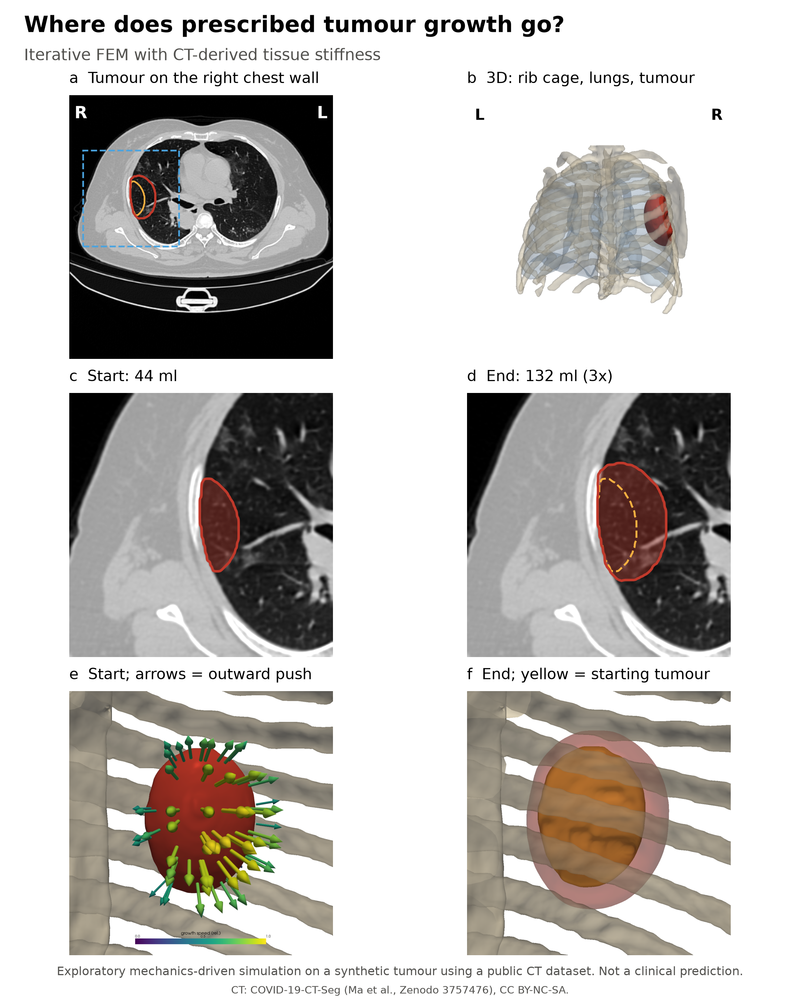
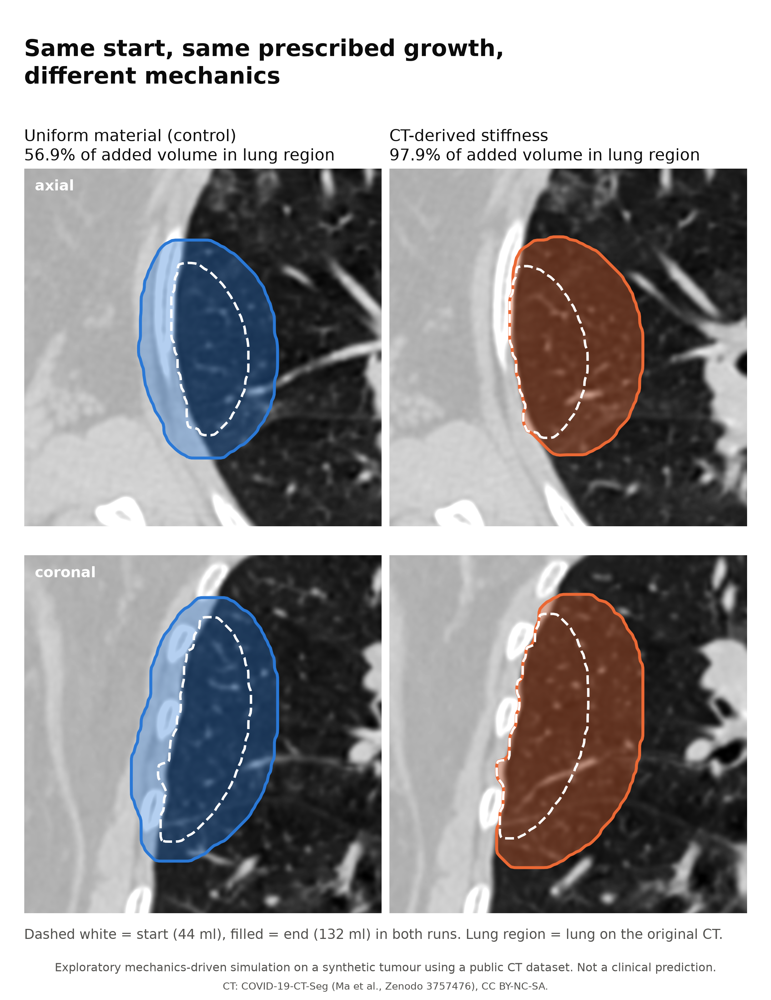
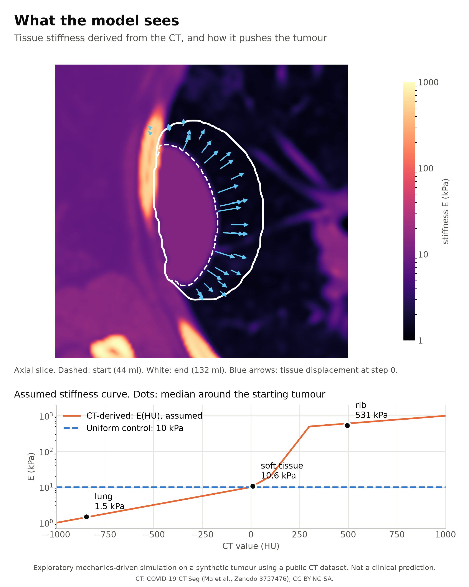

# Where does prescribed tumour growth go?

**An iterative finite-element model on a thorax CT: the amount of tumour growth is prescribed, and the mechanics of the surrounding tissue decide where that growth goes.**

<p align="center"></p>

<p align="center"><sub>Synthetic pleural tumour grown from 44 to 132 ml. Arrows in e: where the finite-element model pushes the tumour surface outward. <i>Exploratory mechanics-driven simulation on a synthetic tumour using a public CT dataset. Not a clinical prediction.</i></sub></p>

`Python` · `scikit-fem` · `PyAMG` · `GMSH` · `level sets` · `nibabel` · `PyVista`

## Research question

> Given a prescribed amount of tumour growth, how does the surrounding mechanical environment influence where that growth goes?

The model does **not** predict how fast a tumour grows, or where a real tumour will grow. The volume is an input. The model only redistributes it.

## Why I revisited this project

For my MSc thesis I built a finite-element model of mesothelioma biomechanics ([mesothelioma-growth-model](https://github.com/sachagijsbers/mesothelioma-growth-model), tag `msc-thesis-2025`). It computed a single deformation step: the CT density pushed on the tumour, and the displacement showed where it bulged outward.

What I did not manage to finish at the time was the loop that turns a deformation into growth: **solve → deform → update the geometry → solve again**. A year later I came back to that problem and built this iterative version.

## From the thesis model to the iterative model

| | MSc thesis model (2025) | Iterative model (this repository) |
|---|---|---|
| FEM domain | tumour only | tumour + lung, soft tissue and ribs |
| What the CT sets | the load (density → pressure) | the resistance (CT value → stiffness) |
| Growth | one deformation step | 6 steps to a prescribed volume |
| Geometry | single mesh | level set on a 1 mm grid, fixed 3 mm host mesh |

The iterative model is an extension and an alternative formulation, not a validated improvement. Details: [docs/THESIS_VS_ITERATIVE.md](docs/THESIS_VS_ITERATIVE.md).

## Key experiment

Same starting tumour, same prescribed growth (44 → 132 ml in 6 steps), same loop. Only the material properties of the surroundings differ:

- **A. Uniform material (control):** E = 10 kPa and ν = 0.45 everywhere.
- **B. CT-derived stiffness:** E from the CT value (lung ~1.5 kPa, soft tissue ~11 kPa, rib ~0.5 MPa), and ν = 0.3 in lung, 0.45 elsewhere.

<p align="center"></p>

## Result

| | Uniform material (control) | CT-derived stiffness |
|---|---|---|
| Added tumour volume | 87.8 ml | 87.8 ml |
| **Share of the added volume within the lung region of the original CT** | **56.9%** | **97.9%** |
| Tumour volume lost | 0 | 0 |

With uniform material, 56.9% of the newly added 3D tumour volume lay within the lung region of the original CT. With CT-derived stiffness, that was 97.9%. Both runs added the same volume, so the difference is in **where** the expansion goes, not in **how much**.

**Metric.** Let $A = T_\text{end} \setminus T_\text{start}$ be the 1 mm³ voxels that are tumour at the end but not at the start, and $L$ the filled right-lung segmentation of the original CT on the same grid. Then

$$\text{lung share} = \frac{|A \cap L|}{|A|}.$$

This is a 3D volume fraction of the added volume only. The model does not deform the anatomy, so "within the lung region" means inside the region that was lung on the original CT, not lung tissue that was actually pushed aside.

**What this supports:** in this model, the same prescribed expansion was redistributed towards the mechanically more compliant tissue once the surroundings got CT-derived properties.

**What it does not show:** that a real tumour grows 98% into the lung. The size of the effect follows from the assumed stiffness curve (lung about 7× softer than the tissue between the ribs) and from the missing pleural sliding. See [limitations](#assumptions-and-limitations).

## How the model works

<p align="center"></p>

Each step solves small-strain linear elasticity on a 150 mm cube around the tumour, with growth as an isotropic eigenstrain inside the tumour:

$$\nabla\cdot\boldsymbol\sigma = \mathbf 0,\qquad \boldsymbol\sigma = \mathbb C(\mathrm{HU}) : \big(\boldsymbol\varepsilon(\mathbf u) - \tfrac{\beta}{3}\chi\,\mathbf I\big),\qquad \mathbf u = \mathbf 0 \text{ on the outer boundary}.$$

The tumour surface then moves with speed $v_n = \max(\mathbf u\cdot\mathbf n, 0)$, scaled so that the volume reaches $V_{k+1} = V_k + \Delta V$, and the loop repeats. The tumour is a level set on a 1 mm grid. It enters a fixed 3 mm tetrahedral host mesh (750,000 elements) through its volume fraction χ per element, so the host mesh does not need remeshing. The system is solved with conjugate gradients and algebraic multigrid.

Full formulation: [docs/MODEL.md](docs/MODEL.md).

## Assumptions and limitations

- **Growth is prescribed, and only its direction is computed.** No biology: no proliferation, nutrients, invasion or stress-dependent growth.
- **The CT → stiffness curve is assumed** (literature order of magnitude), not measured. The result depends on the stiffness *ratios*, which have not been varied yet.
- **Linear elasticity, no pleural sliding, no breathing.** Lung and chest wall are bonded, so the tumour cannot spread along the pleura as real mesothelioma tends to.
- **The anatomy is not deformed**: the tumour takes the place of the tissue it grows into.
- **One CT (a COVID-19 case), one synthetic tumour, one site.** u = 0 on a box 32–35 mm from the final tumour; mesh and boundary sensitivity have not been tested.

All assumptions: [docs/ASSUMPTIONS.md](docs/ASSUMPTIONS.md). What has been verified and what has not: [docs/VALIDATION.md](docs/VALIDATION.md). The solver is checked against the closed-form Eshelby solution for a spherical inclusion (within 1–2%).

## Reproducing the experiment

```bash
git clone https://github.com/sachagijsbers/mesothelioma-iterative-growth
cd mesothelioma-iterative-growth
pip install -e ".[test]"                         # Python >= 3.11

python -m experiments.run_stiffness_control      # downloads the CT, runs A and B, writes metrics + figures
python -m experiments.run_thesis_comparison      # optional: thesis mechanics, several hours
python -m pytest                                 # verification tests, ~20 s
```

`run_stiffness_control` takes about 1.5 hours on a laptop. It writes `results/metrics_stiffness_control.csv` and the three figures in `figures/portfolio/`. With `--skip-simulation`, it recomputes metrics and figures from existing results in about a minute.

## Repository structure

| Path | Contents |
|---|---|
| `src/meso_growth/data.py` | Download of the public CT, lung masks, site and starting tumour |
| `src/meso_growth/geometry.py` | Region of interest, level set, volume update |
| `src/meso_growth/iterative.py` | Iterative model: E(HU), eigenstrain FEM, growth loop |
| `src/meso_growth/thesis_reimpl.py` | Thesis mechanics re-implemented in the same loop (comparison only) |
| `src/meso_growth/metrics.py` | Lung-share metric and sanity checks |
| `src/meso_growth/figures.py` | Portfolio figures |
| `experiments/` | Entry points that reproduce the results |
| `tests/` | Verification tests |
| `docs/` | Model, assumptions, validation, thesis comparison |
| `figures/portfolio/`, `figures/results/` | Generated figures |
| `data/README.md` | Dataset, licence, citation |

## Future work

- Sensitivity of the result to the stiffness ratios and to ν in the lung, to separate the two effects.
- Mesh convergence and the size of the computational domain.
- A sliding contact interface between visceral and parietal pleura.
- Deforming the surrounding anatomy along with the displacement field.
- More cases, real tumour geometries, and comparison with longitudinal follow-up scans.

## Data and licence

CT data: *COVID-19 CT Lung and Infection Segmentation Dataset*, Ma et al., Zenodo, 2020, [doi:10.5281/zenodo.3757476](https://doi.org/10.5281/zenodo.3757476). The data is not included; it is downloaded by the code. See [data/README.md](data/README.md).

Code: MIT. Figures are derived from CT data licensed CC BY-NC-SA and are shared under CC BY-NC-SA 4.0.
