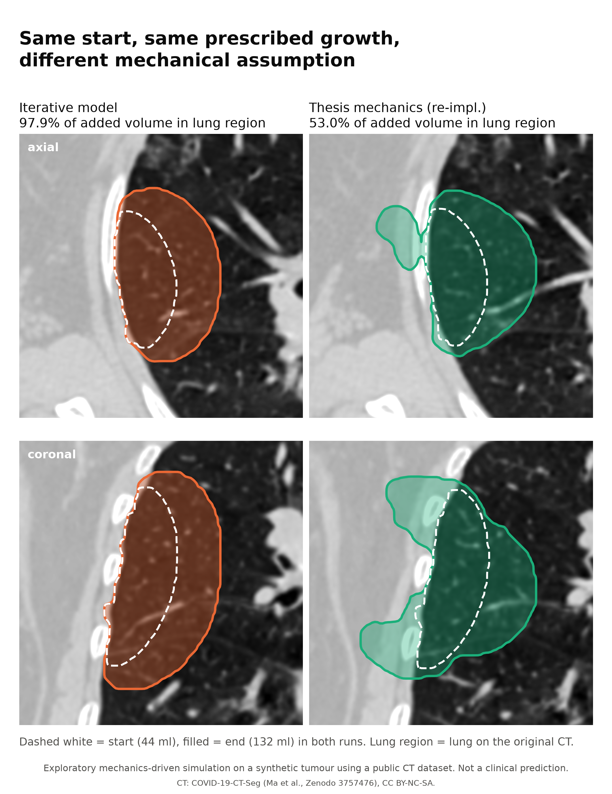

# MSc thesis model vs iterative model

The iterative model is an **extension and an alternative formulation** of the mechanics from my MSc thesis. It is not a corrected or validated version of it. Both rest on assumptions that have not been tested against real tumour growth, so neither can be called "better". What the comparison shows is that **changing the mechanical assumption changes the spatial growth behaviour**.

Three pieces of code are involved:

1. **Original thesis code** (2025): DolfinX/GMSH scripts in [mesothelioma-growth-model](https://github.com/sachagijsbers/mesothelioma-growth-model), tag `msc-thesis-2025`. Single step.
2. **Thesis re-implementation** (this repository, [`thesis_reimpl.py`](../src/meso_growth/thesis_reimpl.py)): the thesis mechanics in scikit-fem, placed in the iterative loop so it can run on exactly the same tumour and growth schedule. Used only for the comparison figure.
3. **Iterative model** (this repository, [`iterative.py`](../src/meso_growth/iterative.py)): new mechanics.

## Comparison

| | Thesis model | Iterative model |
|---|---|---|
| **Question** | Where does the tumour tend to bulge? | Given a prescribed volume increase, where does it go? |
| **FEM domain** | Tumour only | Tumour + surrounding lung, soft tissue and ribs (150 mm cube) |
| **Driving mechanism** | Body force from a density-based pressure $p = k\max(\rho-\rho_0,0)$, directed towards the nearest boundary | Isotropic growth eigenstrain inside the tumour |
| **Role of the CT** | Density ρ(HU) sets the **load** | E(HU) and ν(HU) set the **resistance** of each tissue |
| **Surrounding tissue** | Enters only through the density sampled at tumour nodes | Part of the mechanical domain, with its own stiffness |
| **Boundary conditions** | u = 0 at bone-like nodes (ρ ≥ 2) and at the density-weighted centre | u = 0 on the outer ROI boundary |
| **Material** | Homogeneous, E = 100 kPa, ν = 0.3 | Heterogeneous, E 1 kPa – 1 MPa, ν 0.3 / 0.45 |
| **Geometry evolution** | Single step (`n_growth_steps = 1`); remeshing of the bulged shape was not connected to the loop | Level set updated over 6 steps to a prescribed volume |
| **Remeshing** | Separate script, not in the loop. The re-implementation remeshes the tumour with GMSH every step | None: fixed 3 mm host mesh; the tumour enters through its volume fraction per element |
| **Output** | Displacement field, normalised to a "growth probability", plus candidate bulge points | Tumour geometry per step, displacement and pressure fields, directional metric |
| **Software** | DolfinX, PETSc, GMSH | scikit-fem, PyAMG, GMSH (re-implementation only) |
| **Intended interpretation** | Exploratory map of where the tumour is pushed outward | Exploratory study of how the mechanical environment redistributes a fixed amount of growth |

## Result on the same setup

Same synthetic starting tumour, same CT, same prescribed growth (44 → 132 ml in 6 steps), same level-set update and metric:

| | Added volume within lung region |
|---|---|
| Thesis mechanics (re-implemented) | 53.0% |
| Iterative model, uniform material (control) | 56.9% |
| Iterative model, CT-derived stiffness | 97.9% |

The thesis mechanics grows lobes between the ribs into the chest wall. A plausible reason (an interpretation, not tested): only the tumour is meshed, so the surroundings do not resist expansion, and the direction follows the tumour's shape and the density-based load rather than the tissue around it.

## Differences between the re-implementation and the original

To run the thesis mechanics in the same loop, the re-implementation:

- runs on the synthetic tumour and the public CT instead of the thesis inputs;
- applies the full image affine (the original matched vertex positions in mm to CT voxel indices without it; see its README);
- adds a weak elastic foundation and removes rigid-body motion, because on this tumour no node reaches ρ ≥ 2 and the tumour is held at a single node;
- replaces the "growth probability" and bulge detection with the level-set update $v_n = \max(\mathbf u\cdot\mathbf n, 0)$ used by the iterative model.
